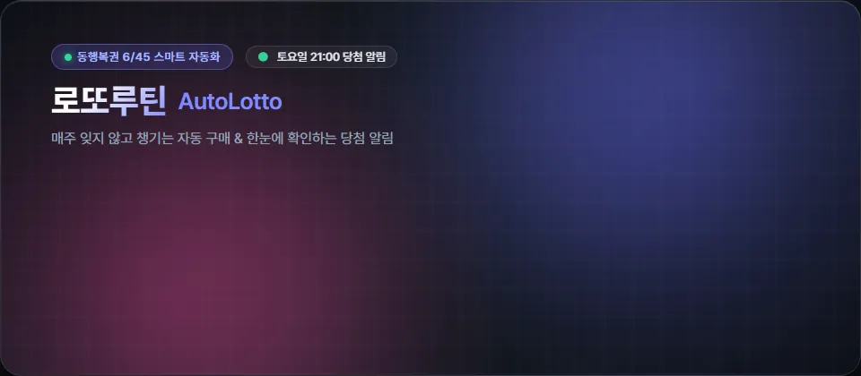

<p align="center">
  
</p>

<h1 align="center">로또루틴 (LottoRoutine)</h1>

<p align="center">
  <b>매주 반복되는 행운의 자동화 루틴 · 동행복권 6/45 스마트 자동 구매 & 당첨 비서</b>
</p>

<p align="center">
  <a href="https://github.com/ree9622/autolotto/releases/latest"></a>
  <a href="https://kotlinlang.org"></a>
  <a href="https://developer.android.com/jetpack/compose"></a>
  <a href="https://developer.android.com"></a>
  <a href="LICENSE"></a>
</p>

---

<p align="center">
  
</p>

## ✨ 핵심 기능

<table>
  <tr>
    <td width="50%">
      <h3>⏰ 스마트 자동 구매</h3>
      <p>매주 원하는 요일과 시간에 최대 5게임까지 지정한 번호 또는 자동으로 오차 없이 자동 구매합니다.</p>
    </td>
    <td width="50%">
      <h3>⚡ 원클릭 즉시 구매</h3>
      <p>저장해둔 조합을 바로 결제하고 추가 게임을 원터치로 구매할 수 있습니다. (서버 주간 5게임 한도 연동)</p>
    </td>
  </tr>
  <tr>
    <td width="50%">
      <h3>🎯 맞춤 번호 관리</h3>
      <p>자신만의 고정 수동 번호와 AI/랜덤 자동 번호를 자유롭게 믹스매치하여 구성할 수 있습니다.</p>
    </td>
    <td width="50%">
      <h3>🏆 실시간 당첨 확인 & 푸시 알림</h3>
      <p>매주 토요일 21:00 추첨 직후, 자동으로 당첨 결과를 조회하고 맞춘 번호와 등수를 알림으로 전송합니다.</p>
    </td>
  </tr>
  <tr>
    <td width="50%">
      <h3>📊 스마트 히스토리 시각화</h3>
      <p>회차별 당첨 번호 미니 볼과 일치 번호 테두리 링으로 이번 주 당첨 여부를 한눈에 시원하게 대조합니다.</p>
    </td>
    <td width="50%">
      <h3>🔒 강력한 보안 암호화</h3>
      <p>동행복권 계정 정보는 Android Keystore(EncryptedSharedPreferences)로 안전하게 격리 보관됩니다.</p>
    </td>
  </tr>
</table>

## 📱 앱 화면 미리보기

<p align="center">
  
  
  
  
</p>

## 🚀 빠른 시작 & 설치 방법

Google Play 도박 정책으로 인해 공식 스토어 등록 대신 GitHub Release를 통해 배포됩니다.

1. **[최신 릴리스 다운로드](https://github.com/ree9622/autolotto/releases/latest)** 페이지에서 `autolotto-1.2.0-universal.apk`를 다운로드합니다.
2. 다운로드 완료 후 파일을 탭하여 설치를 진행합니다.
   - *'출처를 알 수 없는 앱 설치'* 권한 요청 시 브라우저 또는 파일 관리자에 권한을 허용합니다.
3. 앱 실행 후 설정 화면에서 **동행복권(dhlottery.co.kr) 계정**을 연동하고 번호를 설정합니다.

> [!TIP]
> **안정적인 자동 구매를 위한 팁**  
> 백그라운드 자동 구매가 정시에 원활히 실행될 수 있도록 휴대폰 설정에서 로또루틴의 **'배터리 최적화 제외'**를 권장합니다.

## 🛠️ 기술 스택 & 아키텍처

- **UI Framework**: Android Jetpack Compose · Material 3 Expressive 'Lucky Gloss' 테마
- **Programming Language**: Kotlin 2.2 (Coroutine & StateFlow)
- **Background Architecture**: AlarmManager 자가 연쇄 스케줄러 + WorkManager Expedited 작업
- **Security**: Android Keystore 기반 `EncryptedSharedPreferences`, HTTPS RSA PKCS1 통신
- **Update Engine**: GitHub Releases API 인앱 버전 감지 및 패키지 무결성 검증

## 📂 프로젝트 구조

```
app/src/main/kotlin/com/umicorp/autolotto/
├── MainActivity.kt              # 진입점 (Compose setContent)
├── AppContainer.kt              # 앱 스코프 컴포지션 루트
├── dhlottery/                   # 동행복권 통신 엔진
│   ├── AuthService.kt           # RSA 암호화 로그인 & 쿠키 관리
│   ├── PurchaseService.kt       # 로또 구매 엔진 (execBuy.do)
│   ├── ResultService.kt         # 당첨 결과 조회
│   └── HistoryService.kt        # 구매 내역 파싱
├── scheduler/                   # 정밀 백그라운드 스케줄링
│   ├── AlarmScheduler.kt        # AlarmManager 정시 트리거
│   ├── AutoPurchaseWorker.kt    # 백그라운드 자동 구매 처리
│   └── CheckResultWorker.kt     # 토요일 당첨 결과 수집
└── ui/                          # Jetpack Compose UI 계층
    ├── screen/                  # Home · Numbers · History · Settings
    └── theme/                   # Lucky Gloss 네온 & 글래스 테마
```

## 🔐 보안 및 개인정보 보호

- 사용자의 동행복권 비밀번호는 단말 내 **Android Keystore**에 암호화 보관되며 외부 서버로 전송되지 않습니다.
- 동행복권 로그인 통신 시 비밀번호는 동행복권 공식 공개키(RSA)로 단방향 암호화되어 전달됩니다.
- 인앱 업데이트는 배포된 APK의 패키지명과 서명 인증서를 실시간 대조하여 위변조를 원천 차단합니다.

## ⚠️ 주의사항 및 면책 조항

- 본 앱은 동행복권 공식 앱이 아니며, 개인 편의를 위해 개발된 오픈소스 프로젝트입니다.
- 로또 구매를 위해서는 동행복권 계정에 **예치금 충전**이 사전 완료되어 있어야 합니다.
- 복권 구매 가능 시간: 평일/일요일 06:00 ~ 23:59, 토요일 06:00 ~ 19:59 (추첨일 마감 시간 주의).

## 📄 라이선스

이 프로젝트는 [MIT License](LICENSE)에 따라 자유롭게 수정, 배포 및 이용할 수 있습니다.
